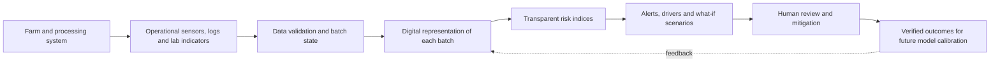

# FoodBio-Twin: Predictive Food Biosecurity & Disease Risk Management

A small, explainable prototype showing how a **digital-twin system** could connect farm biosecurity signals with downstream food-safety indicators to support earlier risk detection and mitigation planning.

> **Status:** research/demo prototype. The included records are synthetic, the weights are illustrative, and the scores are not calibrated probabilities. This is not a validated veterinary, epidemiological, or food-safety decision system.

## Why this project?

Food systems need to combine operational observations, environmental monitoring, laboratory results, and traceability to detect emerging risks earlier. Digital-twin research describes the value of connecting a digital representation to physical-process data and using models to simulate and evaluate risk scenarios. This repository demonstrates that workflow on a small poultry farm-to-processing example.

## What it does

- Loads synthetic batch-level farm and processing observations from CSV.
- Maintains a digital representation of each batch's current observed state.
- Calculates two separate, transparent 0–100 **risk indices**:
  - **Farm disease / biosecurity risk:** biosecurity gaps, visitor pressure, wildlife contact, change in mortality, and ventilation stress.
  - **Food-safety risk:** a normalized laboratory indicator, cooling delay, cold-chain excursion, and sanitation failure.
- Shows the strongest contributing signals and practical prompts for review.
- Simulates two hypothetical interventions (`biosecurity` and `processing_hygiene`) to compare the current state with a possible mitigated state.
- Exports a CSV risk-assessment table for further analysis.

## Run it

Requires Python 3.10+ and the standard library; no packages need to be installed.

```bash
python foodbio_twin.py
```

Specify a different dataset and output file:

```bash
python foodbio_twin.py --input data/sample_batches.csv --output results/risk_assessment.csv
```

Run a what-if scenario:

```bash
python foodbio_twin.py --scenario biosecurity
python foodbio_twin.py --scenario processing_hygiene
```

The included `results/` files are generated example outputs from the synthetic dataset. GitHub Actions also runs the unit tests on pushes and pull requests.

Run tests:

```bash
python -m unittest discover -s tests -v
```

## Example architecture



The current implementation uses CSV input to keep the example reproducible. It does **not** connect to live sensors, laboratory information systems, outbreak feeds, or production control systems. Those would be integration steps for a real deployment.

## Data dictionary

| Field | Meaning | Expected range / unit |
|---|---|---|
| `batch_id` | Unique example batch identifier | text |
| `date` | Observation date | `YYYY-MM-DD` |
| `site_id` | Example farm/site identifier | text |
| `visitor_count` | Visitors in the observation period | non-negative count |
| `biosecurity_compliance_pct` | Checklist compliance | 0–100% |
| `wildlife_contact_index` | Locally normalized wildlife-contact signal | 0–1 |
| `mortality_change_pct` | Change from a site-specific baseline | non-negative % |
| `ventilation_stress_index` | Locally normalized ventilation-stress signal | 0–1 |
| `lab_indicator_index` | Normalized laboratory/microbial-indicator signal | 0–1; requires local method/specification |
| `cooling_delay_min` | Delay before cooling begins | minutes |
| `cold_chain_excursion_min` | Minutes outside the site's defined cold-chain limits | minutes |
| `sanitation_failure_index` | Normalized sanitation deviation/failure signal | 0–1 |

Indices must be defined consistently for the real site and measurement method. A real system should retain raw measurements, timestamps, source, uncertainty, and quality flags as well as any normalized values.

## Scoring logic

The scores are weighted sums of normalized signals. The implementation documents the weights in `foodbio_twin.py`; they are chosen only to make a transparent demonstration and must not be treated as empirically validated. The display bands (low / moderate / high) are illustrative labels, not regulatory thresholds. The model does not estimate outbreak probability or prove that a pathogen is present.

Before operational use, the system would need domain-expert review, validated sensor and laboratory mappings, site- and pathogen-specific evidence, retrospective and prospective validation, uncertainty estimates, drift monitoring, cybersecurity, and integration with existing HACCP, veterinary, and reporting procedures. Human experts remain responsible for interpreting alerts and taking action.

## Suggested next development steps

1. Replace synthetic records with authorized, quality-controlled farm and processor data.
2. Define a data contract and timestamped twin state for each flock, lot, and process step.
3. Calibrate risk factors against verified outcomes and compare against simple baselines.
4. Add time-series forecasting, uncertainty reporting, and alert evaluation (sensitivity, false-alert rate, lead time).
5. Integrate traceability and audited mitigation records; keep access controls and an immutable event log where appropriate.

## References

- Mu, W. et al. (2024). *Making food systems more resilient to food safety risks by including artificial intelligence, big data, and internet of things into food safety early warning and emerging risk identification tools.* **Comprehensive Reviews in Food Science and Food Safety**. https://doi.org/10.1111/1541-4337.13296
- *Implementation of digital twins in the food supply chain: a review and conceptual framework* (2024). **International Journal of Production Research**. https://doi.org/10.1080/00207543.2024.2305804
- Ismail, B. B. et al. (2026). *Digital twin-centered food safety management systems: A review of IoT, AI, and blockchain integration for bacterial pathogen control.* **Food Research International**. https://doi.org/10.1016/j.foodres.2026.119449
- World Organisation for Animal Health (WOAH). *Biological threat reduction.* https://www.woah.org/en/what-we-do/global-initiatives/biological-threat-reduction/


